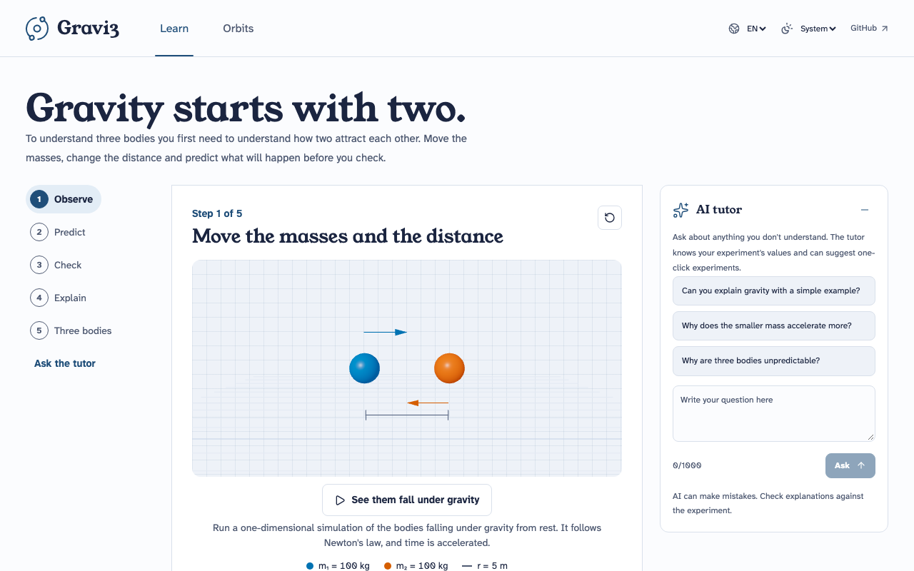
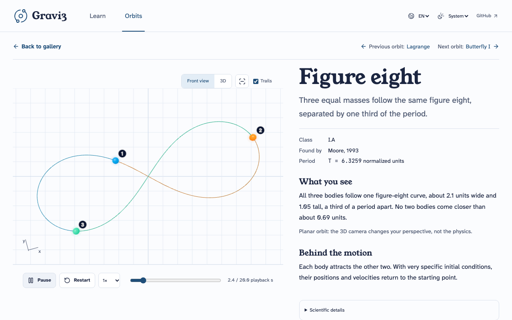

# Gravi3

An interactive course on the **three-body problem**: learn Newton's law of gravitation with an AI tutor, then explore six exact periodic orbits in 3D.

**Live demo: https://gravi3.onrender.com/es** (free Render instance: the first visit may wait a few seconds while it wakes up).




## What it does

- **Calibration** (`/{locale}/learn/calibration`): five short questions, four of them about a 3D animation that stops before the answer, suggest a starting level (explorer, student or advanced) that the learner can change. It lives only in the session.
- **Learn** (`/{locale}/learn`): five chapters of short capsules, one idea per screen, navigated with buttons, dots, arrow keys or swipes and linkable by URL hash. Change masses and distance in a 3D laboratory, predict what doubling the distance does and check it, then add a third body in a live simulator with a 1% perturbation that reveals chaos, and finish in a free laboratory. The level adds or removes capsules and changes how numbers, the formula and simulator readouts are shown; the physics is the same at every level.
- **AI tutor:** answers with the values of your experiment, adapts to the misconception a wrong prediction reveals, and proposes one-click experiments. It is optional: every calculation works without it.
- **Orbits** (`/{locale}/orbits`): gallery and detail pages for six periodic solutions (Lagrange, figure eight, Butterfly I, Goggles, Moth I, Yin-Yang I) generated offline from published initial conditions and validated numerically.

Spanish and English, light and dark themes, keyboard support and a mobile layout.

## Quick start

### With Docker

Needs Docker Engine and Compose v2.24 or newer. Node.js is not required.

```sh
docker compose up --build
```

Open http://localhost:3000. Use `GRAVI3_PORT=3100 docker compose up --build` if the port is taken.

### Locally

Needs Node.js 24.14.0 and pnpm 10.34.9 (pinned in `.nvmrc` and `package.json`).

```sh
nvm use
corepack enable
pnpm install --frozen-lockfile
pnpm dev
```

For a production build use `pnpm build && pnpm start`.

## Enable the AI tutor

Without credentials the app runs in a clearly labelled reduced mode: the laboratory, the simulator and the orbit gallery all work, only the tutor is off.

To enable it, copy `.env.example` to `.env.local` and set the three required values. Every variable is documented in that file.

| Variable       | Meaning                                              |
| -------------- | ---------------------------------------------------- |
| `LLM_API_KEY`  | Provider key, server-side only                       |
| `LLM_BASE_URL` | OpenAI-compatible API base URL (Groq in the example) |
| `LLM_MODEL`    | Model id as named by your provider                   |

Docker Compose reads `.env.local` at runtime and never copies it into the image. On Render, add `LLM_API_KEY` as a secret; `render.yaml` already defines the service.

## Tech stack

Next.js 16 (App Router) and React 19, strict TypeScript, React Three Fiber, `next-intl`, Zod, the `openai` SDK as a generic client, Pino, Vitest and Playwright. No database, accounts or background services.

## Key decisions

- **Orbits are precomputed, not integrated in the browser.** Three-body motion is chaotic, so an offline script (`pnpm orbits:generate`) integrates each orbit with an adaptive Dormand–Prince 5(4) method and the app replays validated samples with cubic Hermite interpolation. Fixed acceptance thresholds and an independent finer integration check energy, momentum, return to the start and convergence ([report](docs/orbit-validation.json)).
- **The AI never does the maths.** Forces are recomputed on the server and the tutor answers around them. It can only propose range-checked actions from an allowlist, and nothing runs until the learner presses its button.
- **Any OpenAI-compatible provider**, selected with environment variables, so reviewers can plug in their own key.
- **Lightweight.** 3D code loads on demand, the home page shows a static preview first and loads its 3D figure-eight afterwards, there is one WebGL canvas per page and paused scenes render on demand.
- **Organised by feature.** `src/features/{home,calibration,learning,orbits,tutor}` each hold their components, pure `model/` logic and 3D scene, and `src/physics` has no framework imports. ESLint enforces these boundaries.

Details: [architecture and tradeoffs](docs/architecture.md) and [numerical model and provenance](docs/physics.md).

## Tests

```sh
pnpm format:check && pnpm lint && pnpm typecheck
pnpm test                      # unit and server tests
pnpm orbits:validate           # committed trajectories against a finer integration
pnpm exec playwright install chromium
pnpm test:e2e                  # desktop and mobile, including accessibility scans
```

CI runs all of the above plus the production build, with no real AI credentials.

## Limits and attribution

- Numerical checks show finite-precision agreement over one period. They do not prove stability.
- Rate limits live in memory, which suits a single-instance demo, not distributed abuse prevention.
- Mobile tests are emulated and accessibility scans are basic checks, not a certification.
- Initial conditions come from Šuvakov and Dmitrašinović, Li and Liao, and the figure-eight authors (see [physics](docs/physics.md)). No third-party animation or implementation code is copied.
