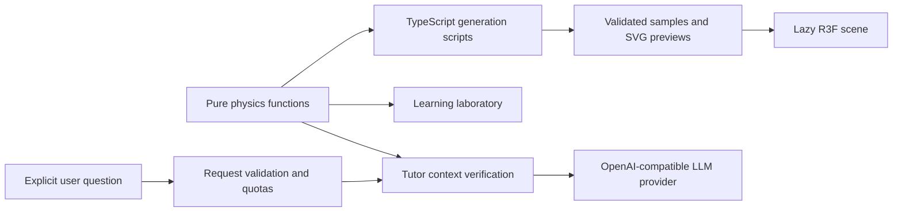

# Architecture and tradeoffs

Gravi3 is one Next.js application and one Node.js process. There is no database, authentication, queue or background service. The browser replays validated data; it does not continuously integrate the three-body problem.

## Responsibilities

| Directory               | Responsibility                                                                                  | Boundary                                                    |
| ----------------------- | ----------------------------------------------------------------------------------------------- | ----------------------------------------------------------- |
| `src/app`               | Routing, server composition, metadata and thin API handlers                                     | No numerical integration in pages                           |
| `src/physics`           | Newtonian equations, integrator, invariants, interpolation and the six-orbit catalogue          | No React, Three.js, Next.js or server imports               |
| `src/features/home`     | Landing page in three capsules (question, why it matters, how you will learn)                   | No other feature's UI                                       |
| `src/features/learning` | Capsule deck (`deck/`), capsules (`capsules/`), force lab (`lab/`) and simulator (`simulator/`) | Scenes cannot alter the physics                             |
| `src/features/orbits`   | Gallery, playback controller, transport UI and orbit scene                                      | Physical time independent of render frames                  |
| `src/features/tutor`    | Tutor panel, client conversation lifecycle, action contract and validation                      | No provider key, model selection or system prompt           |
| `src/features/*/model`  | Pure, framework-free logic and contracts of each feature                                        | The only part of a feature the server and others may import |
| `src/shared/ui`         | Header and providers                                                                            | No feature or server imports                                |
| `src/shared/three`      | Scene palette, body labels, orbit trace, WebGL error boundary, tab visibility                   | No feature or server imports                                |
| `src/shared/constants`  | Routes, asset paths, HTTP statuses and site identity                                            | Plain values; no framework imports                          |
| `src/i18n`              | Locale config, routing and `locales/{es,en}.json` catalogs                                      | Locale list defined once in `config.ts`                     |
| `src/server`            | Env validation, LLM client, limits, prompts and safe logs                                       | Sensitive modules use `server-only`                         |

Each feature groups its own `components/`, `scene/` (3D) and `model/`. A feature never imports another feature's UI, except the tutor panel, which the Learn and Orbits pages embed. Cross-feature and server code may only reach a feature's `model/` folder; ESLint `no-restricted-imports` enforces these boundaries. Each 3D scene lives in the feature that drives it, so a scene and its controller change together. Components are separated where there is a distinct responsibility, not to satisfy arbitrary file-length limits. The physics formula and server evaluation share one implementation.

## Live simulator

The Learn page also integrates three bodies live in the browser (`src/physics/simulation.ts`), reusing the same Dormand–Prince integrator as the offline generator, in normalized units with G = 1 and no softening. Each frame advances at most 0.05 s of wall time × speed, with a bounded step budget so a close encounter cannot freeze the page. Each frame resumes from the step size the previous frame proposed instead of restarting small (about 35–40% less integration work on the Pythagorean preset, measured with Node). Separations below 10⁻³ halt the run as a collision of point masses; an exhausted step budget or an unresolved trial stage halts it as a close encounter rather than a confirmed collision; a body farther than 12 units from the center of mass is reported as an escape. Edited setups are simulated in their center-of-mass frame. When a preset is edited (by the learner, the 1% perturbation or a tutor experiment), the controller keeps running that preset alongside as a reference: the scene draws it as translucent ghosts and the largest distance between both runs is reported, so a "what if" is always compared with the original. Loading another preset ends the comparison. While both runs are going, a frame can spend up to twice the step budget; if the original halts first, it stops costing anything and the comparison freezes with a note. The readouts (energy drift, center of mass, closest separation) are published every 200 ms; positions, trails and velocity vectors update per frame outside React.

The two-body force lab also has a Newtonian radial-fall demonstration (`src/physics/two-body-simulation.ts`). The bodies start at rest; normalized positions and time are scaled by the configured SI masses, separation and gravitational constant, so the accelerated playback follows the same equations while its status reports simulated time. It stops at a small separation before the point-mass singularity; displayed body radii are illustrative, and this lab does not model material collisions.

## State and rendering

Root providers live above the locale segment. Their in-memory session store retains gallery scroll/focus, experiment values and per-orbit playback/camera snapshots during client navigation. Each feature declares its own typed key (`createSessionKey`), so the provider knows nothing about features. Only locale and theme persist after reload, through next-intl and next-themes. A conversation currently belongs to the mounted tutor panel and is discarded when it unmounts or the page reloads; it is never saved to a database or browser storage.

Playback updates a controller independently of React. Positions and trail buffers update through R3F frame callbacks. Controls publish a time snapshot every 150 ms only while playing. Paused canvases render on demand; camera interaction and seeking invalidate the scene. Hidden documents do not advance physical time, and unusually large deltas are bounded on resume. All orbits start paused, including for reduced-motion users.

There is one active canvas per detail and no gallery canvas. DPR is capped at 1.5; no postprocessing, large textures, GPU compute or worker is required. Static previews, explanations and controls remain useful if WebGL is unavailable. Camera gestures retain native vertical scrolling on touch screens; front view disables rotation.

## Tutor request and provider boundary

`GET /api/tutor` reports availability without invoking an LLM. `POST /api/tutor` validates a maximum 16 KiB actual body with a 5-second body-read deadline, 1,000-character message, six history messages of at most 1,000 characters each, `es`/`en`, and an allowlisted learning/orbit context. Unknown fields and browser-provided system roles are rejected.

Learning force and acceleration are recomputed on the server. The learning context also carries the chosen level and the capsule on screen, both validated against closed lists; the level only changes the reply's style (length, formulas, notation), never the verified facts. The client cannot choose model, base URL, prompt, tools or generation budget. Messages/history/predictions remain untrusted even after schema validation. Versioned prompts redirect unrelated questions, explain physical relationships and distinguish periodicity from stability. Prompts mitigate instruction attacks; they do not guarantee factual correctness. Deterministic learning and the scientific catalog remain available independently of AI.

The `openai` SDK is used as a generic OpenAI-compatible client: `LLM_BASE_URL`, `LLM_MODEL` and `LLM_API_KEY` select the provider (Groq in the examples), and `LLM_REASONING_EFFORT` is sent only when configured. A key without base URL or model is a configuration error, not reduced mode. The model answers with a JSON object `{reply, actions}` (`response_format: json_object`, disable with `LLM_JSON_MODE=false`). `src/features/tutor/model/tutor-actions.ts` validates each action against a strict schema, the ranges of the experiment and the actions allowed on the page (Learn: `setExperiment`, `loadPreset`, `perturb`, `scaleBodyVelocity` (one body's starting velocity × 0.5–2) and `setBodyMass`; Orbits: `openOrbit`, `seekOrbit` as a fraction of the period, `setOrbitSpeed` from the player's speeds), keeps at most two and drops the rest. Adaptation is deterministic and server-side: a wrong prediction is mapped to the misconception it reveals (distance treated linearly, or gravity growing with distance), and the context says whether the learner has already run the doubling check; the prompt tells the model to address the misconception first, ask for a guess before answering if there is none, and propose the experiment that refutes it. On orbit pages the context includes the measured closest approach (`ORBIT_CATALOG`, checked against the trajectories by a unit test), so the tutor can move the player there. Plain-text answers are accepted without actions; JSON without a reply is a provider failure. Actions only run when the learner presses their button. No AI Gateway or paid fallback is added. Requests have zero automatic retries, an abort signal and a configurable deadline; completion length is capped including reasoning. Only a nonempty, normally completed answer is returned. Model output is plain text, never HTML. Retry is an explicit user action. The client keeps at most eight displayed messages and sends at most six truncated history messages.

## Quotas and deployment assumptions

Fixed minute/hour windows and a global concurrent-lease count are held in memory. Reservations happen synchronously before the provider call; leases are released in `finally`. Buckets expire on subsequent use and are bounded to 2,000 keys. Counts survive neither restarts nor separate processes. This is appropriate for a single-instance assessment demo, not a distributed abuse-prevention system.

`TRUSTED_PROXY_HOPS=0` is the safe default: incoming IP headers are ignored and requests only count against the global hourly and concurrency limits, so an anonymous visitor cannot exhaust a shared per-client quota. With `N > 0` trusted proxies, the client IP is the N-th `X-Forwarded-For` entry from the end; earlier entries are client-controlled and ignored. That IP is hashed for a bounded key and never logged. Shared IPs can affect legitimate users; global limits remain effective if IPs rotate. CORS/Origin checks are not authentication.

## Logging and privacy

Pino emits JSON events to stdout/stderr, with `LOG_LEVEL`. Startup logs record enabled mode, provider host and configured model. Tutor completion/failure events contain generated request IDs, duration, status, model and sanitized error codes/upstream status. No provider error object, API key, cookies, authorization header, message, history, body, reply or raw IP is logged. Redaction provides an additional safeguard for known sensitive keys; unit tests use synthetic secrets.

Health checks do not call the LLM provider, consume tutor quotas or emit application events. Next.js may log request paths during development; no message is placed in a URL. No third-party analytics or tracking script is used.

## Deliberate limits

- No new-orbit search, conversation storage or user accounts. Live editing is limited to masses and velocities in the Learn simulator.
- Numerical evidence is finite-precision validation of one period, not a proof of stability.
- A free-provider outage or exhausted quota makes the tutor unavailable, without blocking experiments or orbits.
- Automated mobile emulation and accessibility checks do not establish physical-device performance or an accessibility certification.
- Docker is the reproducible delivery path. Render configuration is supplied for the repository owner's manual deployment.
