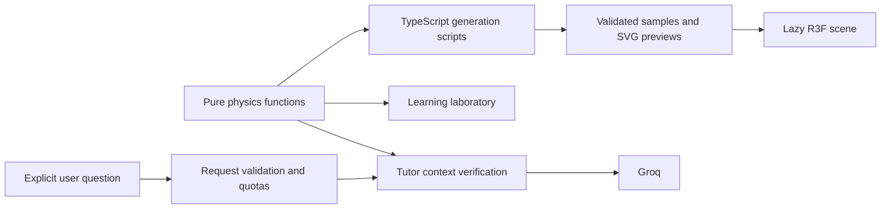

# Architecture and tradeoffs

Gravi3 is one Next.js application and one Node.js process. There is no database, authentication, queue or background service. The browser replays validated data; it does not continuously integrate the three-body problem.

## Responsibilities

| Directory               | Responsibility                                              | Boundary                                          |
| ----------------------- | ----------------------------------------------------------- | ------------------------------------------------- |
| `src/app`               | Routing, server composition, metadata and thin API handlers | No numerical integration in pages                 |
| `src/physics`           | Newtonian equations, integrator, invariants, interpolation  | No React, Three.js, Next.js or server imports     |
| `src/data`              | Catalog, experiment ranges and shared request contract      | No credentials or provider client                 |
| `src/features/learning` | Manipulable SVG laboratory and predictions                  | Force results come from pure physics              |
| `src/features/orbits`   | Library, playback controller and transport UI               | Physical time independent of render frames        |
| `src/visualization`     | Camera, bodies, trails and WebGL lifecycle                  | Consumes samples; cannot alter the physics        |
| `src/components/tutor`  | Bounded client conversation and request lifecycle           | No provider key, model selection or system prompt |
| `src/server`            | Environment validation, Groq, limits, prompts and safe logs | Sensitive modules use `server-only`               |

Features do not import each other's internals. Components are separated where there is a distinct responsibility, not to satisfy arbitrary file-length limits. The physics formula and server evaluation share one implementation.

## State and rendering

Root providers live above the locale segment. Their bounded, in-memory session store retains gallery scroll/focus, experiment values and per-orbit playback/camera snapshots during client navigation. Only locale and theme persist after reload, through next-intl and next-themes. A conversation currently belongs to the mounted tutor panel and is discarded when it unmounts or the page reloads; it is never saved to a database or browser storage.

Playback updates a controller independently of React. Positions and trail buffers update through R3F frame callbacks. Controls publish a time snapshot every 150 ms only while playing. Paused canvases render on demand; camera interaction and seeking invalidate the scene. Hidden documents do not advance physical time, and unusually large deltas are bounded on resume. All orbits start paused, including for reduced-motion users.

There is one active canvas per detail and no gallery canvas. DPR is capped at 1.5; no postprocessing, large textures, GPU compute or worker is required. Static previews, explanations and controls remain useful if WebGL is unavailable. Camera gestures retain native vertical scrolling on touch screens; front view disables rotation.

## Tutor request and provider boundary

`GET /api/tutor` reports availability without invoking an LLM. `POST /api/tutor` validates a maximum 16 KiB actual body with a 5-second body-read deadline, 1,000-character message, six history messages of at most 1,000 characters each, `es`/`en`, and an allowlisted learning/orbit context. Unknown fields and browser-provided system roles are rejected.

Learning force and acceleration are recomputed on the server. The client cannot choose model, base URL, prompt, tools or generation budget. Messages/history/predictions remain untrusted even after schema validation. Versioned prompts redirect unrelated questions, explain physical relationships and distinguish periodicity from stability. Prompts mitigate instruction attacks; they do not guarantee factual correctness. Deterministic learning and the scientific catalog remain available independently of AI.

The OpenAI-compatible SDK calls Groq directly, as selected for this project. No AI Gateway or paid fallback is added. Requests have zero automatic retries, an abort signal and a configurable deadline; completion length is capped including reasoning. Only a nonempty, normally completed answer is returned. Model output is plain text, never HTML. Retry is an explicit user action. The client keeps at most eight displayed messages and sends at most six truncated history messages.

## Quotas and deployment assumptions

Fixed minute/hour windows and a global concurrent-lease count are held in memory. Reservations happen synchronously before the provider call; leases are released in `finally`. Buckets expire on subsequent use and are bounded to 2,000 keys. Counts survive neither restarts nor separate processes. This is appropriate for a single-instance assessment demo, not a distributed abuse-prevention system.

`TRUST_PROXY=false` is the safe default: incoming IP headers are ignored and requests share a conservative bucket. Only enable it after verifying that the deployment's final trusted proxy appends/overwrites `X-Forwarded-For` and untrusted clients cannot supply its final value. The last valid IP is hashed for a bounded key and is never logged. Shared IPs or the shared fallback can affect legitimate users; global limits remain effective if IPs rotate. CORS/Origin checks are not authentication.

## Logging and privacy

Pino emits JSON events to stdout/stderr, with `LOG_LEVEL`. Startup logs record enabled mode and configured model. Tutor completion/failure events contain generated request IDs, duration, status, model and sanitized error codes/upstream status. No provider error object, API key, cookies, authorization header, message, history, body, reply or raw IP is logged. Redaction provides an additional safeguard for known sensitive keys; unit tests use synthetic secrets.

Health checks do not call Groq, consume tutor quotas or emit application events. Next.js may log request paths during development; no message is placed in a URL. No third-party analytics or tracking script is used.

## Deliberate limits

- No live three-body editing, new-orbit search, conversation storage or user accounts.
- Numerical evidence is finite-precision validation of one period, not a proof of stability.
- A free-provider outage or exhausted quota makes the tutor unavailable, without blocking experiments or orbits.
- Automated mobile emulation and accessibility checks do not establish physical-device performance or an accessibility certification.
- Docker is the reproducible delivery path. Render configuration is supplied for the repository owner's manual deployment.
